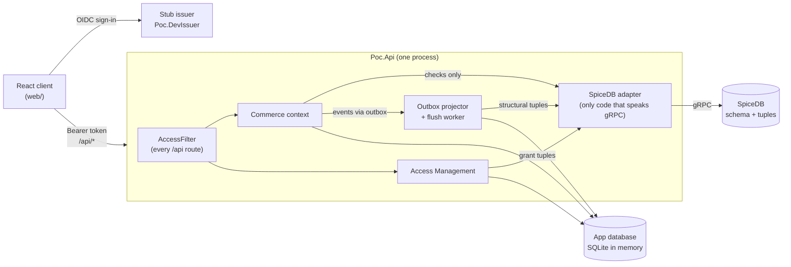
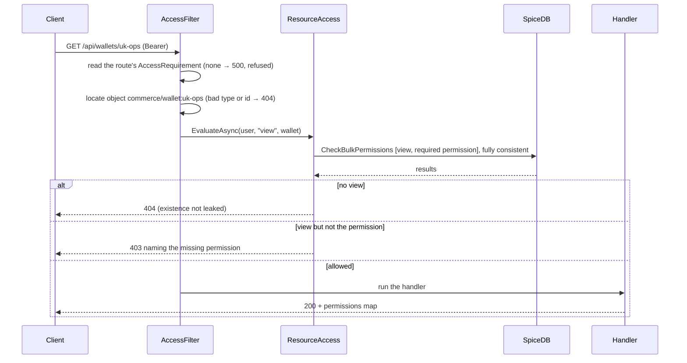
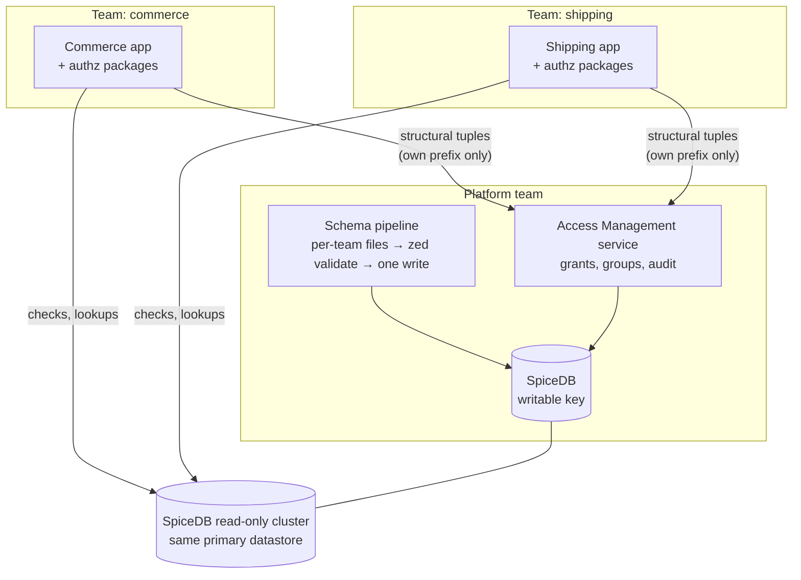

# Architecture

Status: **draft, 2026-11-18.** This document describes the solution as built at commit `34c33f3`. It shows how an
application uses it to enforce authorisation, and how several teams can share one engine using the namespace (type
prefix) convention in `authz/schema.zed`. For detail and evidence, see `PRD.md` (the specification), `DECISIONS.md`
(every choice and deviation, D1 to D8) and `NEXT-STEPS.md` (the plan).

Each statement below is one of three kinds, labelled where it matters:

- **Built**: in the code, with a `file:line` citation, and covered by `./verify.sh`.
- **Proposed**: designed, not built, and not agreed. These come from `NEXT-STEPS.md`.
- **Not verified**: written but never run, or an assumption nobody has checked.

---

## 1. The end-to-end solution

### 1.1 Components



| Component | Responsibility | Where |
|---|---|---|
| Web client | Object screens, the Access tab, a user switcher | `web/src` |
| Stub issuer | Signs tokens for seeded users and publishes OIDC discovery (development only) | `src/Poc.DevIssuer` |
| Endpoint filter | Enforces each route's declared permission, and refuses any route that has no declaration | `src/Poc.Api/Security/AccessFilter.cs` |
| Commerce context | Customers, domains, wallets and subscriptions. It raises domain events and never writes tuples | `src/Poc.Application/Commerce/CommerceService.cs` |
| Access Management | Grants, groups, effective access, the explain function and the grant audit | `src/Poc.Application/Access/` |
| Projector | Turns outbox events into structural (`parent`, `owner`) tuples | `src/Poc.Infrastructure/Projection/OutboxProjector.cs` |
| SpiceDB adapter | Implements the ports over gRPC with Authzed.Net | `src/Poc.Infrastructure/SpiceDb/` |
| SpiceDB | Holds the schema and every relationship, and answers checks and lookups | `authzed/spicedb:v1.57.1` (`docker-compose.yml:11`) |

**The layering is enforced, not just intended:** `Poc.Domain` references nothing, and `Poc.Application` references only
the domain. Only `Poc.Infrastructure` may reference Authzed.Net or gRPC. Only named components may depend on the tuple
writer, `IRelationshipStore`. Architecture tests check each of these (`tests/Poc.UnitTests/Architecture/LayeringTests.cs:59`,
`:102`, `:139`).

### 1.2 The two stores and what each owns

| Store | Holds | Does not hold |
|---|---|---|
| Application database | Business rows, the user and group directory, the outbox, the grant audit | Grants or roles: there are no role tables |
| SpiceDB | The schema, structural tuples (`parent`, `owner`), grant tuples and group membership | Names, balances or any business data |

Grants live only in the engine. The application keeps an audit row for each one (`PRD.md:271`). The same id is used in
the database and in the tuple, so no translation is needed.

### 1.3 Identity

- The API validates JWTs against a configured authority (`src/Poc.Api/Program.cs:24-34`). In development that is the stub
  issuer; B2C or External ID needs only the authority, audience and claim name changed (`PRD.md:411`).
- The caller is the `extension_userId` claim, used as the subject `user:{id}` (`src/Poc.Api/Security/CurrentUser.cs:11-16`).
  The token carries no roles or groups (`PRD.md:407`), so every decision about a resource comes from the engine.
- A fallback policy refuses anonymous callers (`Program.cs:65`), and every `/api` route runs behind the filter
  (`Program.cs:184`).

### 1.4 The authorisation model

Everything sits in a hierarchy of `parent` relations: `platform → customer → commerce/domain → commerce/wallet →
commerce/subscription` (`authz/schema.zed`). Each type follows the same pattern:

```zed
definition commerce/wallet {
    relation parent: commerce/domain              // structural: written by the projector
    relation administrator: user | group#member   // roles: written by Access Management
    relation spender: user | group#member
    relation viewer: user | group#member

    permission admin = administrator + parent->admin              // admin inherits downward
    permission support_view = parent->support_view                // support read inherits downward
    permission view = viewer + spend + support_view
    permission manage_access = admin
    ...
}
```

- **Admin and support inherit downward through `parent->`. Viewer, spender and operator do not** (`PRD.md:17`).
- **Groups** are owned by a customer or by the platform, and can be nested (`group#member`).
- **Application code checks permissions, never relations.** Relations appear in exactly two places: the projector and
  the grant commands (`PRD.md:91`).
- `authz/validation.yaml` holds the seed tuples and the expected-access matrix (88 assertions), run with `zed validate`
  inside `verify.sh`. The matrix may not change without Andrew's agreement (PRD rule 4).

Three rules can't be written in a Zanzibar schema, so the service enforces them in code (`PRD.md:194-200`):

1. A customer's group may be granted only on objects under that customer. A platform group may be granted anywhere,
   but only by a platform administrator.
2. Nested groups must have the same owner.
3. Nesting must not create a cycle.

Rule 1 is stated once (`src/Poc.Application/Access/GrantRules.cs:56`, `:66`). The grant command and the group picker both
use it, and a two-way test checks every seed object and group: a group is offered if and only if granting it succeeds
(`tests/Poc.IntegrationTests/Api/GroupScopeAgreementTests.cs`).

### 1.5 Request flow: a check



- The filter is `src/Poc.Api/Security/AccessFilter.cs:21-48`, and the 404/403 decision is `ResourceAccess.cs:25-36`.
- An engine failure raises `AuthorizationUnavailableException`, which the API returns as 503. A failed check never falls
  back to allow (`PRD.md:87`).
- Every engine call today is fully consistent (`src/Poc.Infrastructure/SpiceDb/SpiceDbConnection.cs:61`).

### 1.6 Request flow: a command that changes structure

1. The filter checks the permission on the object, or on the parent for a create.
2. The handler changes the aggregate and saves it. The row and its outbox events commit in one transaction.
3. The handler flushes the outbox (`CommerceService.cs:148-151`). The projector maps each event to tuples with
   `EventTupleMapper.Map` (`src/Poc.Application/Projection/ProjectionPlan.cs:26`), writes them in sequence order
   (`OutboxProjector.cs:105`), and stores the returned ZedToken on the row.
4. If the engine is unreachable, the API returns **202 with `authorisationPending: true`**. A background flush retries every
   2 s (`src/Poc.Infrastructure/PocOptions.cs:18`). Writes are touches (upserts) and deletes, so replaying an event does
   no harm.
5. A reconciliation job compares the database's `parent`/`owner` references with the engine's tuples every 60 s
   (`PocOptions.cs:20`). It reports drift and repairs only when an administrator asks (`PRD.md:281`).

### 1.7 Request flow: a grant

`AccessService.ChangeGrantAsync` (`src/Poc.Application/Access/AccessService.cs:52-73`) runs these steps:

1. Check `manage_access` on the resource.
2. Check that the relation is grantable on that type. The list comes from the engine's schema (section 3.3).
3. Check that the subject is a user or a group's members.
4. Find where the object sits by walking `parent` tuples **in the engine** (`ObjectHierarchy.PlaceAsync`,
   `src/Poc.Application/Access/ObjectHierarchy.cs:31`). An object with no parent tuple does not exist (404).
5. Apply the group-scope rule and the platform-administrator rule.
6. Write a Pending audit row, then the tuple, then mark the row Applied with the ZedToken. A failed tuple write is
   marked Failed and returned as 503.

One built-in policy adds a default grant: a creator who lacks `admin` on a new subscription (a spender) becomes its
`operator`, through the normal audited grant command
(`src/Poc.Application/Projection/DefaultGrantPolicy.cs:17`).

### 1.8 Start-up (PoC behaviour, not production)

At start-up the app (`src/Poc.Infrastructure/Startup/StartupSequence.cs`) does the following:

1. Waits for the engine.
2. **Writes the whole schema** (`:44`).
3. Loads the access model from the engine (`:46`).
4. **Deletes every relationship of every type** (`:51-52`).
5. Reseeds the database, flushes the outbox and issues the seed grants.

This suits a PoC where both stores are in memory. It is **unsafe on a shared engine** (see section 4.5).

### 1.9 Deployment

- Locally: four processes (SpiceDB, issuer, API, Vite); see `README.md`.
- `docker-compose.yml` defines `spicedb`, `issuer` and `api` (`:10`, `:24`, `:38`). **Not verified:** Compose has never
  run on this machine (D3, D7), so phases 5 and 6 are complete except D3/D7, not accepted.

---

## 2. Using it in an application to enforce authorisation

Today all of this lives in one monolith, and this app is its only consumer. Section 2 describes the pattern a team
follows. Packaging it as NuGet packages is **Proposed** (`NEXT-STEPS.md`, step 6).

### 2.1 Define your types in the schema

Put each resource type under your team's prefix, and give it the shape the access layer recognises (section 3.2):

```zed
definition shipping/parcel {
    relation parent: customer
    relation handler: user | group#member

    permission admin = parent->admin
    permission view = handler + admin + parent->support_view
    permission manage_access = admin
}
```

This example is the type used in `tests/Poc.IntegrationTests/Api/NewTeamTypeTests.cs:18-24`. That test shows such a type
working through the Access endpoints with **no C# for it anywhere**.

Add your types' expected access to `validation.yaml`, so `zed validate` checks the matrix.

### 2.2 Declare the permission on every endpoint

Each route states what it needs as metadata, and one filter enforces it:

```csharp
api.MapGet("/wallets/{id}", ...)
   .RequiresOn(WalletSchema.Permissions.View, ResourceLocator.Route(WalletSchema.Type));

api.MapPost("/domains/{id}/wallets", ...)                 // create: check on the parent
   .RequiresOn(DomainSchema.Permissions.CreateWallet, ResourceLocator.Route(DomainSchema.Type));

api.MapGet("/children", ...)                               // any team's type, named in the query string
   .RequiresOn(PlatformSchema.Permissions.View, ResourceLocator.QueryTyped("type", "id"));
```

(Excerpts from `src/Poc.Api/Endpoints/ObjectEndpoints.cs:76`, `:70` and `BrowseEndpoints.cs:34`.)

| Declaration | Use for |
|---|---|
| `RequiresOn(permission, locator)` | Any route about an object. The filter checks `view` and the permission together |
| `HandlerChecked(permission, reason)` | The object is named in the request body. The handler calls `ResourceAccess.RequireAsync` before doing anything |
| `Authenticated(reason)` | Caller-scoped routes such as `/me`, `/tree` and the user picker |
| `Anonymous(reason)` | `/health` and the API description only |

These are defined in `src/Poc.Api/Security/AccessRequirement.cs:66-85`. **It fails closed:** a route with no
declaration is refused at run time (`AccessFilter.cs:21`), and a test lists every endpoint and fails if any lacks one
(`tests/Poc.IntegrationTests/Api/EndpointDeclarationTests.cs:50`). Other tests in that file check that:

- every declared permission exists in the schema (`:78`);
- a user with no access gets 404 from every resource route (`:114`);
- a support user gets 403 on every route that changes data (`:139`).

### 2.3 Check a second object in the handler

When a request touches two objects, such as a wallet move (`move` on the wallet and `create_wallet` on the target), the
handler calls `ResourceAccess.RequireAsync`, the same function the filter uses. This keeps the 404/403 rule from
diverging (`ResourceAccess.cs:17-21`).

### 2.4 Filter lists through the engine

List endpoints ask the engine which ids the caller can view (`LookupResources`), then intersect those with the database
query (`src/Poc.Application/Queries/ObjectReadService.cs:45`, `:89`). Nothing is returned that the caller cannot view.

### 2.5 Return a permissions map; never trust it

Each object response carries the caller's permissions, computed with one bulk check (`PRD.md:296`). The client uses the
map to enable or disable controls. The server re-checks every request.

### 2.6 Write structural tuples through the outbox, never grants

- Your aggregate raises events (`WalletCreated`, `WalletMoved`, and so on), and they commit with the row.
- Your projector maps each event to `parent` tuples. Handle every event type: an unmapped event throws
  (`ProjectionPlan.cs`, the `_ =>` arm).
- **Never write grant tuples.** Grants go through Access Management, so the scope rules and audit apply. The layering
  test forbids Commerce code from depending on the tuple writer (`LayeringTests.cs:139`).
- When an object is deleted, delete its tuples. An object with no `parent` tuple stops existing as far as the access
  layer is concerned (`ObjectHierarchy.cs:31`).

### 2.7 Status codes your clients will see

| Situation | Status |
|---|---|
| Not signed in, or the token has no `extension_userId` | 401 |
| The caller cannot `view` the object, it doesn't exist, or its id is malformed | 404 (all three look the same) |
| The caller can view the object but lacks the permission | 403, with `permission` in the problem details |
| A grant breaks a rule (`unknown_relation`, `group_owner_mismatch`, …) | 422 |
| The row was saved but its tuples are not yet written | 202, `authorisationPending: true` |
| The engine is unavailable | 503 |

---

## 3. Supporting multiple teams: the namespace concept

### 3.1 Ownership model (Andrew's working assumptions, 2026-11-15; not commitments)

- **One shared SpiceDB.**
- **The platform team** owns the shared types (`user`, `platform`, `customer`, `group`), every grant, and a central Access
  Management service.
- **Each app team** owns its own resource types and the structural tuples for them, and consumes the access layer as
  NuGet packages (Proposed).

### 3.2 Type prefixes (D8, built)

| Kind | Naming | Examples |
|---|---|---|
| Shared, platform-owned | Unprefixed | `user`, `platform`, `customer`, `group` |
| Team-owned | `team/type`, one prefix level | `commerce/domain`, `commerce/wallet`, `commerce/subscription` |

These are the reasons for the prefix (`DECISIONS.md`, "Team-prefixed object types (D8)"):

- A type name is stored in every tuple, so adding a prefix after go-live would mean rewriting every tuple.
- "Team X defines only `x/` types" becomes a mechanical check.
- Two teams can each have a `wallet`.
- It is the form SpiceDB documents for several products in one organisation. That is quoted from D8; the source URL is
  not recorded there.

**What the engine accepts.** Observed on SpiceDB v1.57.1, 2026-11-17:

- Each part needs at least 3 characters: lowercase letters, digits and underscores.
- `bl/wallet` and `ab` are refused for being too short.
- `Billing/wallet` (uppercase) and `billing-wallet` (hyphen) are refused.
- `billing/sub/wallet` is accepted, but nesting is not used.

**The API names an object in the query string, never in the path**: `/api/access/grants?type=commerce/wallet&id=uk-ops`.
A path segment cannot carry the `/`, and encoding it as `%2F` depends on every router and proxy treating it the same way.

### 3.3 What the access layer reads from the deployed schema (built, steps 3 and 4)

The central layer has no per-team code. At start-up it calls SpiceDB `ReflectSchema` and derives an `AccessModel`
(`src/Poc.Application/Access/AccessModel.cs`) using these rules:

| Concept | Rule | Code |
|---|---|---|
| **Resource type** (may be named in a request, takes grants) | `platform`, or any definition with a `parent` relation and the `view` and `manage_access` permissions | `AccessModel.cs:78-82` |
| **Grantable role** | A relation of a resource type whose every allowed subject is `user` or `group#member`, with no wildcard and no caveat | `AccessModel.cs:84-89` |
| **Structural relation** | Anything that points at an object (`parent`, `owner`), which is never offered as a role | same |
| **Object exists** | It has exactly one `parent` tuple (`platform:main` always exists) | `ObjectHierarchy.cs:31-61` |
| **Root customer** (for group scope) | Found by walking `parent` tuples up the engine, not by reading any team's database | `ObjectHierarchy.cs` |
| **Valid id for another team's type** | The engine's own rule: `[a-zA-Z0-9/_|=+-]`, 1 to 1024 bytes, not `*` | `src/Poc.Application/Authorization/EngineObjectId.cs:20` |

Classifying by **subject type rather than by name** is what makes this safe across teams. A team cannot add a
structural relation that accidentally shows up as a role, because a structural relation points at an object. Teams have
to agree only on the people types, and the platform owns those.

Before a schema is loaded, the model is empty: no type resolves (404) and nothing is grantable (`AccessModel.cs:41`).

### 3.4 The contract for a team's type

To plug into the shared layer, a team type must:

1. Use the team's prefix.
2. Have exactly one `parent` relation, pointing at a shared type (`customer`) or one of the team's own types.
3. Define `view` and `manage_access`.
4. Inherit administration and support from its parent (`admin = … + parent->admin`,
   `support_view = parent->support_view`) to match the platform's model. **Not enforced:** nothing checks this today.
5. Have every role accept only `user | group#member`.
6. Write its `parent` tuple when an object is created and delete its tuples when it is deleted.

Items 1 to 3 and 5 decide whether the type is recognised. Item 4 is a convention that a schema-pipeline lint could
enforce (Proposed).

### 3.5 What is not yet safe for several teams

These gaps stand between the PoC and a shared engine. Each one is in `NEXT-STEPS.md`.

| Gap | Why it matters | Status |
|---|---|---|
| **The app writes the whole schema at start-up** (`StartupSequence.cs:44`) | A schema write replaces the whole schema. On a shared engine one team's deploy would delete other teams' definitions; the engine refuses only where data exists (observed 2026-11-15 and 2026-11-17). The proposed fix is a pipeline that compiles each team's file, runs `zed validate` on each, then makes one serialised write | Proposed (step 2.2) |
| **Start-up deletes every tuple of every type** (`StartupSequence.cs:51-52`) | This would wipe every team's data | Proposed (step 2.1) |
| **References across teams can cross customers** | Observed 2026-11-17: a `shipping/parcel` under customer C2, paid from a `billing/wallet` under C1, was viewable by C1's administrator through `payer->spend`. SpiceDB does not prevent this | **Open**: needs a design decision (step 5) |
| **Every preshared key can write anything** | Open-source SpiceDB keys are not scoped (docs checked 2026-11-15). The proposal is a second cluster with `--datastore-readonly` for app teams, while app projectors write structural tuples through a central endpoint that checks the team owns the type. **Not tested:** whether ZedTokens work across the two clusters | Proposed (step 6) |
| **Full consistency on every call** | Correct but expensive at scale. The proposal is at-least-as-fresh with the stored ZedToken, and full consistency for access-management screens | Proposed (step 2.4) |
| **In-memory stores** | The app database is SQLite in memory (`src/Poc.Infrastructure/InfrastructureServiceCollectionExtensions.cs:35`), and SpiceDB uses its memory datastore | Proposed (step 2.3, needs CI for Postgres) |
| **The resource tree lists only this app's types** | Another team's objects can be reached by link or by the `/access?type=&id=` page, but not by browsing (PRD rule 5 intersects with this app's tables) | By design for now |
| **No packages yet** | Teams cannot consume the layer yet | Proposed (step 6) |

### 3.6 Target shape (Proposed)



---

## 4. What is verified and what is not

**Verified** (by `./verify.sh` at the commits listed in `DECISIONS.md`):

- the access matrix in `validation.yaml`;
- every endpoint is declared and enforced;
- layering;
- outbox replay and outage behaviour;
- a new team's type (`shipping/parcel`) working end to end through the API with no C# for it;
- the engine-walk group scope agreeing with grants;
- the engine id rule.

**Not verified:**

- **Docker Compose has never run** (D3, D7).
- No browser test opens the Access page for another team's type, or for an id that contains `/`, `|`, `+` or `=`.
- Behaviour on Postgres or CockroachDB. Note that CockroachDB's docs say `fully_consistent` does not guarantee
  read-after-write there (as recorded in `NEXT-STEPS.md`).
- ZedTokens across a read-only cluster.
- The inheritance convention in section 3.4, item 4, is not checked by any tool.
- `verify.sh` has no recorded pass on the current tree (`34c33f3`). That commit changed Markdown only. The code is
  unchanged since `13a4e5d`, which the commit hook allowed only after `verify.sh` passed.
